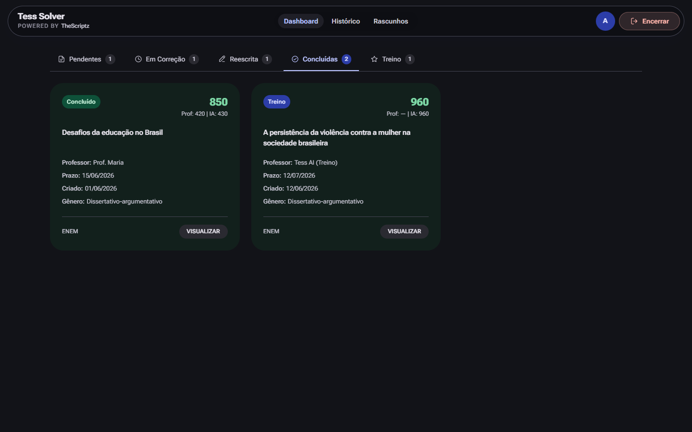

# Redação Paraná Hack

**Painel Tess Solver.** Escreva redações com IA humanizada e corrija com nota por competência (padrão Enem).

[Site](https://thescriptz.fun) · [Landing](https://thescriptz.fun/redacao-parana-hack) · [Planos](https://thescriptz.fun/planos)

## O que é

O Redação Paraná Hack é o painel dedicado do TheScriptz para a Redação Paraná. O Tess Solver gera redações humanizadas com IA, corrige com nota no padrão da banca do Paraná/Enem e organiza rascunhos e treinos em um só lugar. Feito para escolas `@escola.pr.gov.br`.

## Recursos

- IA humanizada — texto natural, sem "cara de IA"
- Correção com nota por competência (padrão Enem/Paraná)
- Rascunhos com foto do caderno e transcrição automática
- Modo Treino para praticar sem impacto no histórico
- Histórico completo das redações concluídas

## Como usar

1. Escolha um plano em [thescriptz.fun/planos](https://thescriptz.fun/planos).
2. Acesse o painel de Redação com seu email `@escola.pr.gov.br`.
3. Escreva com IA, corrija ou treine — cada aba cobre um fluxo.
4. Envie a redação diretamente ou salve para revisar depois.

## Perguntas frequentes

**A redação gerada pela IA é detectável pelo professor?**
O Tess Solver usa passes de humanização que quebram os padrões clássicos de detectores automáticos, com variação de vocabulário, ritmo e conectivos.

**Consigo corrigir uma redação escrita à mão?**
Sim. Você tira foto do caderno, o painel transcreve automaticamente e você pode corrigir ou usar o texto como base para uma nova versão.

**Preciso instalar bookmark ou extensão?**
Não. O painel do Redação Paraná é uma página própria; você faz login com o email escolar e usa direto no navegador.

## Planos e preços

| Plano | Preço | Período |
|---|---|---|
| Semanal | R$ 5,97 | 7 dias |
| Mensal | R$ 14,97 | 30 dias |
| Trimestral | R$ 34,97 | 90 dias |
| Anual | R$ 119,97 | 365 dias |

Todos os planos incluem o bookmark e os painéis disponíveis. Pagamento via Pix; renovar antes do vencimento soma o novo período ao tempo restante.

## Links

- **Site oficial:** [thescriptz.fun](https://thescriptz.fun)
- **Landing Redação Paraná:** [thescriptz.fun/redacao-parana-hack](https://thescriptz.fun/redacao-parana-hack)
- **Instalar:** [thescriptz.fun/instalar](https://thescriptz.fun/instalar)
- **Planos:** [thescriptz.fun/planos](https://thescriptz.fun/planos)
- **Perfil no GitHub:** [github.com/thescriptz](https://github.com/thescriptz)
- **Suporte:** [WhatsApp](https://wa.me/5562981046894)

## Aviso

O código-fonte do TheScriptz é privado. Este repositório contém apenas informações públicas do produto.

O TheScriptz é independente e não possui vínculo com o Governo do Paraná, a Secretaria de Estado da Educação do Paraná ou os organizadores do Enem.
